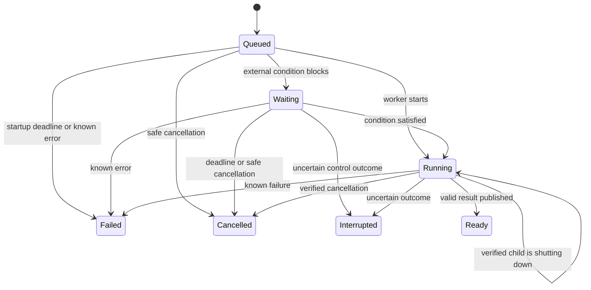
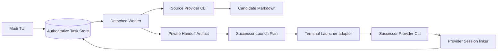

# Mudi Assisted Handoff PRD

> Legacy local record. It preserves prior Handoff detail, but does not replace the formal
> GitHub Issue PRD process, `CONTEXT.md`, or accepted ADRs.

| Field | Value |
|---|---|
| Status | Legacy local record |
| Last updated | 2026-08-04 |
| Product phase | Post-v1 |
| Parent direction | `attention-first-ui-prd.md` |
| Artifact contract | Section 11 of this legacy record |

## 1. Purpose

Assisted Handoff lets a user ask an existing Claude Code or Codex CLI Session to produce a
durable, structured handoff for a new Successor Session. Mudi owns the bounded local
workflow, keeps working after its TUI exits, notifies the user when the result is ready, and
then lets the user launch or copy a successor command.

Handoff completion and Successor launch are separate. A Handoff Operation succeeds when it
produces a valid Handoff Result; opening another terminal is a later user choice.

## 2. Problem

Long-running coding Sessions accumulate decisions, changed files, verification evidence,
and unresolved work. Context pressure may suggest that a fresh Session would be useful,
but manually reconstructing that working state is slow and error-prone. Directly resuming
the same transcript does not create a fresh context and does not support changing Provider.

The user needs a workflow that:

- captures the current working state without modifying the source Project;
- survives Mudi TUI exit;
- distinguishes generation success from launch and linkage success;
- supports Claude-to-Codex and Codex-to-Claude continuation;
- never treats an Alert or Context threshold as authorization.

## 3. Goals

- Produce one validated Handoff Artifact and one provider-specific Successor Launch Command.
- Support Busy, Idle, and Exited source Sessions when concrete eligibility checks pass.
- Support same-Provider and cross-Provider successors, defaulting to the source Provider.
- Keep every Control Operation explicit, bounded, local, and recoverable.
- Continue authorized work after the TUI exits and surface terminal outcomes persistently.
- Preserve source Project and Worktree contents during Artifact generation.
- Link a launched Successor only when Provider-native identity evidence is conclusive.

## 4. Non-goals

- Automatically initiate Handoff when Current Context crosses a threshold.
- Merge, clone, or migrate Provider-native Transcripts or Session IDs.
- Give Mudi persistent control over a Session or Project.
- Write a Handoff Artifact into the source Project by default.
- Let the Provider write directly into Mudi's private Artifact directory.
- Automatically retry an uncertain or failed Prompt.
- Require `tmux`, a background daemon, or terminal keystroke injection.
- Support non-macOS terminal launch adapters in the first implementation.
- Store Prompt bodies, Provider output, tool content, or Artifact bodies in either store.

## 5. Product invariants

1. Passive observation is the default. Attention Conditions, Alerts, thresholds, and time
   never authorize a Control Operation.
2. One authorization covers one declared workflow attempt until its deadline. Retry always
   requires a new authorization and a new Operation Task.
3. A source Session may have at most one non-terminal Operation Task. Different source
   Sessions may run Tasks concurrently.
4. Handoff generation is read-only toward the source Project and Worktree.
5. A Task becomes `Ready` only after its declared Artifact passes validation and is
   atomically published.
6. Task execution state, Task Acknowledgement, terminal launch, and Successor linkage are
   independent facts.
7. Terminal Tasks are immutable. Retry creates a linked successor Task rather than reopening
   the predecessor.
8. A guessed process, Session ID, Artifact, or result is never accepted as evidence.

## 6. Domain outcomes

### 6.1 Handoff Result

A successful Handoff Result contains:

- one owner-only Handoff Artifact;
- one Successor Launch Plan from which the selected Provider's copyable command is derived.

The Artifact and Launch Plan can be opened, copied, launched, or left for later without
changing the Task's `Ready` state.

### 6.2 Successor Session

A Successor Session is always a new Provider-native Session with a distinct native Session
ID. It receives working context only through the Handoff Artifact. Its Provider may differ
from the source Provider.

Launching a command does not prove that a Successor Session exists. Mudi records the
relationship only after Provider evidence ties the launched process to a new native Session
source record.

## 7. User experience

### 7.1 Home layout

The home page has a compact upper status strip above the full-width `PROJECTS` (`NOW`)
region. The upper-left third remains intentionally empty. The upper-right places
`RECENT SIGNALS` and `TASKS` side by side; both are supporting status surfaces and share
the strip's small fixed height.

```text
                         +------------------------++------------------------+
                         | RECENT SIGNALS         || TASKS                  |
                         |                        ||                        |
                         +------------------------++------------------------+
+--------------------------------------------------------------------------+
| PROJECTS / NOW                                                           |
|                                                                          |
+--------------------------------------------------------------------------+
```

`TASKS` is focusable and keyboard-scrollable. Compact layouts may reduce its visible
viewport but do not remove retained Tasks from its timeline.

### 7.2 Task rows

Each row exposes enough metadata to identify the work without showing Provider content:

- operation type;
- source Provider and Session or Project label;
- current Operation Task State;
- unread treatment for an unacknowledged terminal outcome;
- time of the most recent state transition.

Rows form one timeline ordered by most recent execution-state transition, newest first.
Creation and state transitions update the ordering timestamp. Heartbeats, progress polls,
notification delivery, and user interaction do not. Remaining ties use creation time and
stable Task ID, both newest first.

### 7.3 Starting Handoff

The Session detail Handoff flow shows:

- source Provider, native Session ID, Project or Worktree, lifecycle state, and Current
  Context when known;
- Successor Provider selection, defaulted to the source Provider;
- whether an Open Current Run must be ended;
- the read-only Project and Worktree generation guarantee;
- fixed Task deadlines;
- one explicit confirmation for this workflow attempt.

If the source Session is Open, confirmation must explicitly authorize ending its Current
Run safely. Declining that authority does not create a Task.

### 7.4 Completion and acknowledgement

Every terminal transition is persisted in `TASKS`. Mudi also sends a best-effort
macOS notification without Provider conversation or Artifact content. Notification delivery
failure does not affect Task state.

A `Ready` Task offers:

- `Open Terminal`;
- `Copy Command`;
- `Close for Later`;
- `Delete Task and Artifact`.

`Failed`, `Interrupted`, and `Cancelled` Tasks offer state-appropriate details, manual Retry
when permitted, dismissal, and deletion. Opening Task detail or deliberately acting on its
notice writes `acknowledged_at`. Notification delivery, row rendering, and TUI startup do
not. Acknowledgement changes only unread presentation.

### 7.5 Retention and deletion

Tasks and Artifacts do not expire automatically. Every retained Task remains in the
scrollable `TASKS` timeline after acknowledgement.

Only terminal Tasks offer `Delete Task and Artifact`. The action requires an explicit,
irreversible confirmation and removes the Task Store record, owned Artifact, Launch Plan
metadata, and interaction metadata. It never deletes either Provider Session, a Transcript,
Project, Worktree, or open Terminal. A retained retry may keep only a deleted predecessor's
Task ID as an unavailable historical reference.

## 8. Eligibility and authorization

Current Context and Context Alerts may recommend Handoff but never gate it. Busy, Idle, and
Exited source Sessions are eligible when:

- the source Provider is supported and its CLI executable is available;
- the native Session ID and provider source record still exist;
- the original working directory exists and is readable;
- the source Session has no other non-terminal Operation Task;
- the selected Successor Provider CLI is available.

Provider authentication and similar conditions that cannot be established reliably by
preflight become execution failures rather than false eligibility claims.

One authorization stores the selected source, Successor Provider, declared ability to end
an Open Current Run, and workflow deadline. It expires when the Task reaches a terminal
state or its unused `Waiting` authority reaches the fixed deadline.

## 9. Operation Task states

### 9.1 State definitions

| State | Terminal | Meaning |
|---|---:|---|
| `Queued` | No | Authorization is stored; Worker startup is not yet established. |
| `Waiting` | No | A declared external condition blocks execution, such as waiting for the source Current Run to become Idle and exit. |
| `Running` | No | Worker or Provider execution is active, including verified graceful shutdown. |
| `Ready` | Yes | A valid declared Handoff Result exists. |
| `Failed` | Yes | A known failure occurred and no valid result exists. |
| `Interrupted` | Yes | The outcome cannot be established safely and requires user decision. |
| `Cancelled` | Yes | Execution stopped with a certain cancellation outcome, including expiry before control was used. |

### 9.2 State machine



Terminal states have no outgoing transition. A manual Retry creates a different Task in
`Queued` with `retry_of_task_id` pointing to the terminal predecessor.

### 9.3 Deadlines

| Stage | Fixed deadline | Required behavior |
|---|---:|---|
| `Queued` | 30 seconds | Worker startup not established becomes `Failed`. |
| `Waiting` | 2 hours | Unused control authorization expires and becomes `Cancelled`. |
| `Running` | 30 minutes | Begin graceful termination of the Task-owned Provider process and reconcile. |

The `Running` deadline is not permission to use `SIGKILL`. While a verified process is
still shutting down, the Task remains `Running`. A valid result becomes `Ready`, a known
failure without a valid result becomes `Failed`, and uncertainty becomes `Interrupted`.
No deadline automatically resubmits a Prompt.

### 9.4 Cancellation

Every non-terminal Task offers `Cancel Task` behind a confirmation. Cancellation expresses
intent; evidence determines the result:

- before a Provider Prompt or control action, it becomes `Cancelled`;
- after Task-owned Provider startup, Mudi requests graceful termination;
- valid result evidence still becomes `Ready`;
- verified termination without a result becomes `Cancelled`;
- an unresolvable process or result outcome becomes `Interrupted`.

Cancellation never force-kills a process, targets an unverified PID, closes the user's
Terminal or shell, or starts a retry.

### 9.5 Manual retry

`Failed` and `Cancelled` Tasks may offer Retry. An `Interrupted` Task offers Retry only
after reconciliation proves that its previous Worker and Provider are no longer running.
`Ready` does not offer Retry; regenerating its result is a new Handoff Operation.

Every Retry receives a new Task ID, Artifact path, authorization, deadlines, and current
precondition checks. It never overwrites or reopens its predecessor.

## 10. Execution architecture



### 10.1 Task Store

Operation Task metadata lives in an authoritative Task Store separate from the disposable,
rebuildable Session index. The Store owns state transitions and concurrency claims but not
Provider or Artifact content.

Required metadata includes:

- Task ID, operation type, source Provider and native Session ID;
- selected Successor Provider and source working directory reference;
- state, creation time, state-transition time, and stage deadlines;
- validated Worker and Provider process identity needed for reconciliation;
- Artifact path and result readiness metadata;
- normalized failure reason without raw Provider output;
- acknowledgement and launch interaction timestamps;
- optional `retry_of_task_id`;
- optional confirmed Successor Provider, native Session ID, and linkage time.

The Store never contains Prompt bodies, generated Markdown, raw stdout or stderr, tool
arguments, tool output, Transcript content, or source-code content. Fixed instructions and
copyable commands are derived from templates and stored metadata.

### 10.2 Detached Worker

Each authorized Task is executed by one detached Rust invocation of the Mudi binary.
It continues if the TUI exits. The TUI interacts through a small task-execution interface
and does not own Worker, Provider command, reconciliation, or Artifact-writing details.

The first implementation deliberately avoids an in-process Tokio Task, a required daemon,
`tmux`, and terminal keystroke injection. A future daemon may replace per-Task Workers
behind the same interface.

### 10.3 Source Provider execution

The first explicitly authorized Handoff installs one canonical, versioned
`mudi-handoff` Skill into both Provider-standard user Skill directories. Installation
and managed updates are atomic and owner-only. Mudi updates only copies carrying its
ownership marker and refuses an unrelated same-name Skill.

Authorization preflight verifies the managed copies before Task creation. The detached Worker
revalidates the selected source Provider's copy immediately before Provider startup, then resumes
the source Session non-interactively and explicitly invokes the Skill through standard input:

```text
Codex:  codex exec --sandbox read-only resume <native-session-id> -
        $mudi-handoff
Claude: claude --print --resume <native-session-id> --bare --permission-mode plan --tools "" --strict-mcp-config
        /mudi-handoff
```

Claude's bare mode keeps explicitly invoked Skills available while disabling unrelated hooks,
plugins, MCP servers, agents, project instructions, and other customizations; the empty tool set
prevents tool use. The Skill contains the complete Artifact contract and returns candidate
Markdown as final output without writing files or invoking tools. The Worker remains the sole
Artifact writer.

### 10.4 Ending an Open Current Run

Resuming a Session while its manual Current Run is open risks concurrent Transcript writes.
When explicitly authorized, Mudi:

1. waits while the Current Run is Busy;
2. revalidates process identity after it becomes Idle;
3. requests the Provider CLI process to exit without closing its Terminal or shell;
4. proceeds only after exit is observed.

Mudi never terminates a Busy Run, targets an unverified PID, or escalates to
`SIGKILL`. The authorization expires after two hours if no control action occurred.

### 10.5 Reconciliation

A restarted TUI or Worker reconciles every non-terminal Task against:

- validated Worker and Provider liveness;
- process-start identity to prevent PID reuse;
- the declared final Artifact and its validation contract.

A live verified process remains non-terminal, a valid result becomes `Ready`, and an
outcome that cannot be established becomes `Interrupted`. Mudi never automatically
resubmits an `Interrupted` Prompt.

## 11. Artifact contract

Each Handoff Artifact is fixed UTF-8 Markdown with these required headings in order:

```markdown
# Handoff

## Objective

## Current State

## Decisions

## Completed

## Remaining

## Files Changed

## Verification

## Risks And Blockers

## Next Action
```

`Objective`, `Current State`, `Remaining`, and `Next Action` must contain non-whitespace
content. Each section contains only working context needed by a Successor Session. The
Artifact must not contain a complete Transcript, secrets, or unrelated tool output.

Before an Operation Task becomes `Ready`, the Worker validates the candidate in memory as
valid UTF-8, non-empty, and structurally complete. The authoritative Task Store keeps only
result metadata and the Artifact path, never the Artifact body. The Worker is the sole
Artifact writer: it writes an owner-only temporary file and atomically renames it to the
declared path only after validation. Invalid or interrupted output never appears as a
completed Artifact.

Artifacts live under Mudi's private data directory, use Task IDs rather than user
content in filenames, and remain outside the source Project. The directory mode is `0700`
and file mode is `0600`. The Provider has read access to the source Project for generation
but no write access to the Artifact directory; the Successor command is explicitly granted
read access to its completed Artifact.

The managed Skill uses the resumed source Session context without invoking tools. It must not
edit files, install dependencies, commit changes, launch tools or agents, or run new tests during
Artifact generation.

## 12. Successor launch and linkage

### 12.1 Successor Launch Plan

Core Handoff logic produces a platform-neutral structured Plan containing:

- source working directory;
- selected Successor Provider executable;
- argument list;
- Handoff Artifact reference.

It does not embed AppleScript or interpolate an unescaped shell command. Platform-specific
launch and copy renderers consume the same Plan.

The v1 Terminal Launcher adapter opens a new macOS `Terminal.app` window in the source
working directory and leaves its shell open after the Provider CLI exits. Unsupported
terminal applications use `Copy Command`. Future terminal and operating-system adapters
do not change Task, Artifact, or Provider semantics.

A launch failure leaves the Task `Ready`, reports the error, and keeps `Copy Command`
available.

### 12.2 Foreground launch helper

`Open Terminal` and the default copied command invoke a foreground Mudi launch
helper. The helper loads the validated Plan, starts the interactive Successor Provider with
the Terminal's inherited standard input and output, and records only process metadata. It
does not proxy or persist the interactive conversation.

The target Provider adapter maps the validated launched process to a new native Session:

- Claude resolves the PID-associated state record;
- Codex resolves the rollout file held by the launched process.

Both paths validate process start time, confirm the source record, and then store
`successor_session_id` and `successor_linked_at`. Neither Provider preassigns an ID, and
Mudi never chooses the newest Session by working directory. If the user bypasses the
helper or evidence remains inconclusive, the Task stays `Ready` and displays
`Successor Session not linked`.

## 13. Privacy and security

- All execution and storage are local.
- Session source logs remain authoritative for observed Session identity and state.
- The disposable Session index stores reconstructable metadata only.
- The authoritative Task Store stores authorized workflow metadata and result references
  only.
- Artifact content exists only in the owner-only Artifact file.
- No Alert, threshold, notification, or elapsed duration grants authority.
- Every process action revalidates PID and process-start identity.
- Project generation is read-only and never grants the Provider Artifact-directory write
  access.
- Launch commands use structured executable arguments and platform-specific escaping.
- Completion notifications contain no Prompt, Provider output, or Artifact body.

## 14. Failure contract

| Failure point | Required outcome |
|---|---|
| Source or target CLI unavailable during preflight | Handoff is ineligible; no Task is created. |
| Worker startup not established in 30 seconds | `Failed`. |
| Provider authentication fails after startup | `Failed` with a normalized reason. |
| Source remains Busy until the two-hour deadline | `Cancelled`; unused authority expires. |
| Source process identity or termination outcome is uncertain | `Interrupted`; never target or retry automatically. |
| Candidate Markdown is invalid | `Failed`; no final Artifact is published. |
| Worker disappears but a valid final Artifact exists | `Ready`. |
| Worker or Provider is verified live after restart | Preserve the current non-terminal state. |
| Worker disappears after Prompt send and result cannot be proved | `Interrupted`; do not resend. |
| macOS notification fails | Preserve terminal Task state and unread presentation. |
| `Open Terminal` fails after `Ready` | Remain `Ready`; report failure and retain `Copy Command`. |
| Successor starts but native ID cannot be linked | Remain `Ready`; show `Successor Session not linked`. |

The accepted stress case is a Codex-to-Claude Handoff whose Worker disappears after sending
the source Prompt but before publishing an Artifact. It becomes `Interrupted`, requires
conclusive process absence and fresh authorization before Retry, and never promotes partial
output. A successful retry becomes `Ready`; any later terminal or linkage failure remains a
separate interaction outcome.

## 15. Acceptance criteria

### Authorization and concurrency

- No Alert, Context threshold, or lifecycle transition creates a Task.
- Open source Sessions require explicit authority to end their Current Run.
- One source Session never has two non-terminal Tasks.
- Tasks for different source Sessions may execute concurrently.
- Waiting authority expires after two hours and never executes later.

### Execution and recovery

- An authorized Task continues after the TUI exits.
- Worker, Provider, and result evidence reconcile after restart without guessing.
- No automatic retry, Prompt resend, or `SIGKILL` occurs.
- Cancellation outcome follows evidence rather than the requested label.
- Manual Retry creates a new, linked, freshly authorized Task.

### Artifact

- A Task cannot become `Ready` without the exact Artifact validation contract.
- Provider candidate output cannot directly write or replace the final Artifact.
- Final publication is atomic and owner-only outside the Project.
- Generation does not modify the Project or Worktree.

### UI and notification

- The upper-right status row keeps every retained Task reachable in confirmed time order.
- Unread presentation changes only after deliberate acknowledgement.
- `Close for Later` preserves a discoverable Result.
- TUI exit does not suppress Worker completion or persistent Task state.
- Notification failure cannot lose a Task outcome.

### Successor

- Same-Provider and cross-Provider launch plans use the same Artifact.
- Terminal launch failure never invalidates a `Ready` Result.
- Successor linkage uses launched-process evidence and never newest-log guessing.
- Source and Successor Sessions retain distinct Provider-native identities and Transcripts.

### Retention

- No Task or Artifact expires automatically.
- Only terminal Tasks may be explicitly deleted.
- Deletion removes Mudi-owned Task and Artifact data without affecting either
  Provider Session or an open Terminal.

## 16. Deferred work

- Replace per-Task Workers with a long-lived daemon behind the same execution interface.
- Copy or snapshot a complete source Session context into a separate directory.
- Add configurable timeouts, automatic retention, bulk deletion, and storage reporting.
- Add terminal adapters for Linux, Windows, iTerm2, Ghostty, Warp, and other terminals.
- Export an Artifact into a Project through a separate explicit operation.
- Add automatic or threshold-triggered Control Operations.

## 17. Related decisions

- `docs/adr/0002-explicitly-authorized-control.md`
- `docs/adr/0003-detached-operation-task-workers.md`
- `docs/adr/0004-end-current-run-safely-for-handoff.md`
- `docs/adr/0005-keep-handoff-artifacts-outside-projects.md`
- `docs/adr/0006-separate-successor-launch-from-terminal-adapters.md`
- `docs/adr/0007-link-successors-through-launched-process-evidence.md`

The canonical vocabulary remains in `CONTEXT.md`. This PRD owns Handoff product behavior;
Section 11 of this record preserves the exact historical Artifact format.
